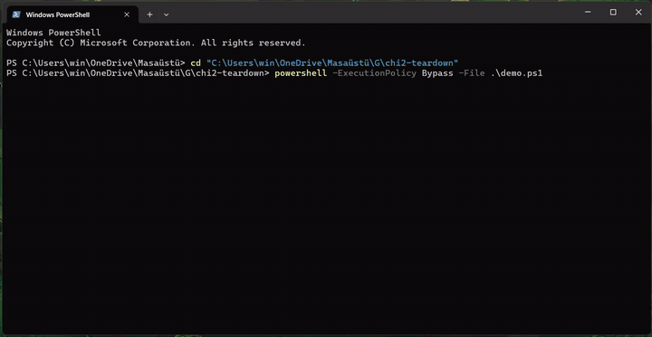

<div align="center">


# χ² Power Teardown


<p>
  
  
  
  
  
</p>

<a href="#-english"><b>🇬🇧 English</b></a> · <a href="#-türkçe"><b>🇹🇷 Türkçe</b></a>

</div>

<br>

<table align="center">
  <tr>
    <td align="center" width="25%"><br><b>Oracle</b><br><sub>50 G*Power vectors</sub></td>
    <td align="center" width="25%"><br><b>Teardown</b><br><sub>REA + Ghidra</sub></td>
    <td align="center" width="25%"><br><b>Clean room</b><br><sub>spec-only rewrite</sub></td>
    <td align="center" width="25%"><br><b>100% match</b><br><sub>589 / 589</sub></td>
  </tr>
</table>

##  Demo

<div align="center">
  <br><sub>demo.ps1: a priori, post hoc, invalid input, conformance report</sub><br><br><a href="https://youtu.be/uQfWS3_VzAE"></a><br><a href="https://youtu.be/uQfWS3_VzAE"></a>
</div>

---

## 🇬🇧 English

> ⚠️ **This project is not G\*Power and is not a replacement for it.** G\*Power's χ² contingency table calculation was studied for educational purposes, its behaviour was documented with evidence, and it was rewritten independently. The delivered code contains no decompiled output.

###  Demo Video

> **In the video:** `demo.ps1` runs, in order, an a priori calculation (N = 220, same as G\*Power next to it), a post hoc calculation (power = 0.6236), an invalid input (`w = 0` → G\*Power's error message, exit code 2) and the conformance report (**100% N match**).

###  About the Project

**χ² Power Teardown** is a small command-line program that reproduces the *"χ² tests → Goodness-of-fit tests: Contingency tables"* calculation of G\*Power, a widely used statistics tool. Given effect size **w**, **α**, **power** and **df**, it computes the required sample size (a priori) or the power reached with a given sample (post hoc).

The real goal is not the program itself but **the proof that it is correct**. The work was therefore done in three separate stages:

1. 🎯 **Oracle:** The correct answers were first collected from G\*Power itself (50 vectors, each with a screenshot).
2. 🕵️ **Inspection (Session 1):** An AI agent used REA + Ghidra to look inside `GPowerNT.exe` and find out how the calculation works. Every claim was tied to a function address, and a specification (`SPEC.md`) was written from those findings.
3. 🧼 **Clean-room implementation (Session 2):** A separate agent that never saw any Ghidra output wrote the program **only** from the specification and the oracle.

###  Key Features

* 📐 **Two modes:** `a-priori` (required N) and `post-hoc` (achieved power)
* 🧾 **Single-line JSON output:** `ncp`, `critical_chi2`, `n_total`, `actual_power` / `power`
* 🚫 **Same validation as G\*Power:** Same ranges, same order, same error messages; exit code `2` on error
* 🔎 **Evidence ledger:** Every behaviour is tagged `[REA]` (binary evidence), `[DOK]` (manual) or `[AJAN]` (agent, no evidence)
* 🧪 **Differential testing:** Automatic comparison against the G\*Power vectors + 567 scipy scale vectors
* 🤖 **Hallucination log:** 3 confident-but-wrong claims made by the agent, and the tests that caught them

###  Completed Layers

| Layer | Points | Status |
| :--- | :---: | :---: |
| Core: engine + CLI | 85 | ✅ Done |
| MCP server | +15 | ⏳ Bonus |
| AI agent | +10 | ⏳ Bonus |

###  Version and Target

| | |
| :--- | :--- |
| Inspected | G\*Power 3.1.9.7 (Windows, build 143), downloaded only from psychologie.hhu.de (`GPowerWin_3.1.9.7.zip`) |
| `GPowerNT.exe` SHA-256 | `C63E6A133EB6372932F810C08CC33DC35A06D1DDB658F897BD6C34A754EFC812` |
| Zip SHA-256 | `3BB7F1F2478D74EE5BA701AE7F849373CF2B8A11F6B6216C7C6B236DB7861199` |
| Test family | χ² tests · Goodness-of-fit tests: Contingency tables (`chi2-contingency`) |
| Modes | `a-priori`, `post-hoc` |
| Contract version | `1.0.0` ([CONTRACT.md](CONTRACT.md), [course gist](https://gist.github.com/seyyah/08d3e031781d853b17366be8ba264211)) |
| Tools | REA 6.7.0 (`rea-agents`), Ghidra 12.1.4, Eclipse Temurin JDK 21.0.12 |

`GPowerNT.exe` (called `GPower.exe` in the assignment text) is not and will not be in this repository (`.gitignore`).

###  Method and Data Flow

```text
[ G*Power 3.1.9.7 GUI ]
        │  collect_gpower.ps1 → 50 vectors + 50 screenshots
        ▼
[ oracle/gpower_vectors.csv ] ◄──────────────────────────────┐
        │                                                     │
        ▼  Session 1 · REA + Ghidra                           │
[ GPowerNT.exe ] → LEDGER.md (31 [REA] proofs) → SPEC.md      │
        │                    └→ HALLUCINATIONS.md (H1–H3)     │
        ▼  Session 2 · clean room (SPEC + oracle only)        │
[ src/engine ] ← [ src/cli: gpower-clone ]                    │
        │                                                     │
        ▼  tests/diff_test.py ────────────────────────────────┘
[ tests/REPORT.md ]  gate: exact a priori N match ≥ 90%
```

###  Key Findings

Behaviours not written in the manual but found in G\*Power's GUI and binary (details: `SPEC.md`, `LEDGER.md`):

| Behaviour | What does G\*Power do? | Oracle |
| :--- | :--- | :---: |
| N search | Does not try integers one by one; finds a root over continuous N (Brent), then rounds up | G001–G021 |
| Upper bound | None: N = 7 848 861 for w = 0.001 | G014 |
| Minimum N | 1; no df-dependent lower bound | G016 |
| Power = α | Accepted, returns N = 1; error if power < α | G017, G018 |
| Fractional N (post hoc) | No error, rounded to the nearest integer (10.2→10, 10.5→11) | G036–G038 |
| Fractional df | No error, used as is (df = 2.5) | G028 |
| Display | Normally 7 decimals; very small (< ~0.01) and ≥ 100 values use `%.7g` | G020, G039–G050 |

###  Conflicts Between the Contract and G\*Power

`CONTRACT.md` §5 requires out-of-range inputs to be rejected with `OUT_OF_RANGE`. G\*Power, however, computes some of these inputs without error:

| Vector | Input | Contract §5 | G\*Power 3.1.9.7 |
| :---: | :--- | :--- | :--- |
| G028 | `df = 2.5` | df integer ≥ 1 → reject | Fractional df used as is, N = 115 |
| G035 | post hoc `n_total = 1` | n_total ≥ 2 → reject | Power = 0.0603726 |
| G036–G038 | post hoc `n_total = 10.2 / 10.5 / 10.7` | integer → reject | Rounded to nearest integer (10 / 11 / 11) |
| G039 | post hoc `w = 0` | w > 0 → reject | Power = α = 0.05 |

Because the hidden tests run on the contract's harness, this implementation follows **the contract outside the valid range** and G\*Power inside it. The ambiguity should be reported on the course thread (contract §11).

###  Installation and Usage

```bash
# 1. Clone the repo
git clone https://github.com/huseyinbaranisik/G-Power.git
cd G-Power

# 2. Install (Python ≥ 3.10; only dependency is scipy)
python -m venv .venv && .venv/Scripts/python -m pip install -e ".[test]"
# macOS / Linux: .venv/bin/python -m pip install -e ".[test]"

# 3. The command is now .venv/Scripts/gpower-clone (macOS/Linux: .venv/bin/gpower-clone)
.venv/Scripts/gpower-clone --version
# {"contract_version": "1.0.0", "name": "G-Power (huseyinbaranisik)", "engine": "Python 3.14.3"}
```

```bash
# A priori: required sample size
gpower-clone --test chi2-contingency --mode a-priori --w 0.3 --alpha 0.05 --power 0.95 --df 5
# {"ncp": 19.8, "critical_chi2": 11.070497693516351, "n_total": 220, "actual_power": 0.9502155018970164}

# Post hoc: achieved power
gpower-clone --test chi2-contingency --mode post-hoc --w 0.3 --alpha 0.05 --n_total 50 --df 5
# {"ncp": 4.5, "critical_chi2": 11.070497693516351, "power": 0.32717853371574623}

# Invalid input → error JSON, exit code 2
gpower-clone --test chi2-contingency --mode a-priori --w 0 --alpha 0.05 --power 0.8 --df 1
# {"error": "Effect size w must be greater 1e-06.", "code": "OUT_OF_RANGE", "field": "w"}
```

Numbers are printed at full double precision as the contract requires (CONTRACT §2.3); the comparison tolerance is 1e-6.

Tests:

```bash
.venv/Scripts/python -m pytest -q                      # 137 tests + 3 intentional xfails (bonus modes)

# Differential test (gpower-clone must be on PATH)
PATH="$PWD/.venv/Scripts:$PATH" python tests/diff_test.py oracle/gpower_vectors.csv oracle/scale_vectors.csv
# -> tests/REPORT.md
```

###  Conformance Report

| Metric | Result |
| :--- | :--- |
| 🚪 **Gate:** exact a priori N match | **589 / 589 = 100%** (threshold 90%) ✅ |
| `gpower_vectors.csv` (G\*Power screen) | 44 / 50; the other 6 are the **contract conflicts** above |
| `scale_vectors.csv` (scipy scale oracle) | 567 / 567 |
| Independent check at contract tolerance (≤ 1e-6) | 50 oracle rows + 2 public chi2 vectors: no issues |
| pytest | 137 passed, 3 intentional xfails (bonus modes with no rule in SPEC) |
| Slowest call | 0.69 s (limit 2 s) |

Details: [tests/REPORT.md](tests/REPORT.md) and the Session 2 report [RAPOR.md](RAPOR.md) (including open questions on the SPEC and the contract).

###  REA Check

> *"Are the REA tools and the Ghidra provider available in this session?"*

`TODO: screenshot of the answer (e.g. docs/rea_kontrol.png)`

According to the session's own check (`binary_session`), the Ghidra provider is **available**: version 12.1.4, eight out of eight checks passed (configuration, platform, architecture, installation, version, headless, native decompiler, Java).

###  Project Structure

```
G-Power/
├── README.md               # This file
├── CONTRACT.md             # Course CLI contract v1.0.0 (from the gist)
├── SPEC.md                 # Algorithm description + Gherkin acceptance criteria (Session 1)
├── LEDGER.md               # Evidence ledger: [REA] / [DOK] / [AJAN]
├── HALLUCINATIONS.md       # The agent's wrong inferences (H1–H3)
├── AGENT_COST.md           # Agent, tokens, number of attempts
├── prompts/
│   ├── session1_inceleme.md   # First message of Session 1
│   └── session2_yazim.md      # First message of Session 2
├── oracle/
│   ├── gpower_vectors.csv     # 50 G*Power vectors (main oracle)
│   ├── screenshots/           # G*Power screenshot for every vector
│   ├── collect_gpower.ps1     # Script that collects the vectors from G*Power
│   ├── public_vectors.jsonl   # 25 public reference vectors from the contract
│   ├── scale_vectors.csv      # 567 scipy vectors (scale oracle)
│   └── gen_scale_oracle.py
├── RAPOR.md                # Session 2 report: conflicts, questions on the SPEC
├── demo.ps1                # 60-second video demo
├── docs/
│   └── demo.mp4               # Demo video
├── pyproject.toml          # Package definition, gpower-clone command
├── src/
│   ├── engine/                # Single calculation engine (validation, N search, Brent)
│   └── cli/                   # gpower-clone: arguments → engine → single-line JSON
└── tests/
    ├── test_*.py              # Oracle, Gherkin scenarios, public vectors, contract
    ├── diff_test.py           # Differential test (course harness)
    └── REPORT.md              # Conformance report
```

###  Citation

Faul, F., Erdfelder, E., Lang, A.-G., & Buchner, A. (2007). G\*Power 3: A flexible statistical power analysis program for the social, behavioral, and biomedical sciences. *Behavior Research Methods, 39*, 175–191.

Faul, F., Erdfelder, E., Buchner, A., & Lang, A.-G. (2009). Statistical power analyses using G\*Power 3.1: Tests for correlation and regression analyses. *Behavior Research Methods, 41*, 1149–1160.

The G\*Power authors provide this tool to the scientific community free of charge; the only official distribution is psychologie.hhu.de.

---

## 🇹🇷 Türkçe

> ⚠️ **Bu proje G\*Power değildir ve onun yerine geçmez.** G\*Power'ın χ² olumsallık tablosu hesabı eğitim amacıyla incelenmiş, davranışı kanıtlarla belgelenmiş ve bağımsız olarak yeniden yazılmıştır. Teslim edilen kodda decompile çıktısı yoktur.

###  Demo Videosu

> **Videoda:** `demo.ps1` ile sırayla a priori (N = 220, yandaki G\*Power ile aynı), post hoc (güç = 0.6236), geçersiz girdi (`w = 0` → G\*Power'ın hata iletisi, çıkış kodu 2) ve uyum raporu (**N eşleşmesi %100**).

###  Proje Hakkında

**χ² Power Teardown**, istatistikte yaygın kullanılan G\*Power programının *"χ² tests → Goodness-of-fit tests: Contingency tables"* hesabını taklit eden, terminalden çalışan küçük bir programdır. Etki büyüklüğü **w**, **α**, **güç** ve **df** verildiğinde gereken örneklem büyüklüğünü (a priori) ya da verilen örneklemle ulaşılan gücü (post hoc) hesaplar.

Projenin asıl amacı programın kendisi değil, **neden doğru olduğunun kanıtıdır**. Bu yüzden iş üç ayrı aşamada yapıldı:

1. 🎯 **Kâhin:** Doğru cevaplar önce G\*Power'ın kendisinden toplandı (50 vektör, her biri ekran görüntülü).
2. 🕵️ **İnceleme (Oturum 1):** Bir yapay zeka ajanı REA + Ghidra ile `GPowerNT.exe`'nin içine bakıp hesabın nasıl yapıldığını buldu. Her iddia bir fonksiyon adresine bağlandı ve bu bulgulardan bir şartname (`SPEC.md`) yazıldı.
3. 🧼 **Temiz oda yazım (Oturum 2):** Ghidra çıktısını hiç görmeyen ayrı bir ajan, programı **yalnızca** şartnameden ve kâhinden yazdı.

###  Temel Özellikler

* 📐 **İki mod:** `a-priori` (gereken N) ve `post-hoc` (ulaşılan güç)
* 🧾 **Tek satır JSON çıktı:** `ncp`, `critical_chi2`, `n_total`, `actual_power` / `power`
* 🚫 **G\*Power ile aynı doğrulama:** Aynı aralıklar, aynı sıra, aynı hata iletileri; hatada çıkış kodu `2`
* 🔎 **Kanıt defteri:** Her davranış `[REA]` (binary kanıtı), `[DOK]` (kılavuz) ya da `[AJAN]` (kanıtsız) olarak etiketli
* 🧪 **Diferansiyel test:** G\*Power vektörleri + 567 scipy ölçek vektörü ile otomatik karşılaştırma
* 🤖 **Halüsinasyon günlüğü:** Ajanın kendinden emin ama yanlış çıkan 3 iddiası ve onları yakalayan testler

###  Yapılan Katmanlar

| Katman | Puan | Durum |
| :--- | :---: | :---: |
| Temel: motor + CLI | 85 | ✅ Tamam |
| MCP sunucusu | +15 | ⏳ Bonus |
| AI ajanı | +10 | ⏳ Bonus |

###  Sürüm ve Hedef

| | |
| :--- | :--- |
| İncelenen | G\*Power 3.1.9.7 (Windows, build 143), yalnızca psychologie.hhu.de'den indirildi (`GPowerWin_3.1.9.7.zip`) |
| `GPowerNT.exe` SHA-256 | `C63E6A133EB6372932F810C08CC33DC35A06D1DDB658F897BD6C34A754EFC812` |
| Zip SHA-256 | `3BB7F1F2478D74EE5BA701AE7F849373CF2B8A11F6B6216C7C6B236DB7861199` |
| Test ailesi | χ² tests · Goodness-of-fit tests: Contingency tables (`chi2-contingency`) |
| Modlar | `a-priori`, `post-hoc` |
| Sözleşme sürümü | `1.0.0` ([CONTRACT.md](CONTRACT.md), [ders gist'i](https://gist.github.com/seyyah/08d3e031781d853b17366be8ba264211)) |
| Araçlar | REA 6.7.0 (`rea-agents`), Ghidra 12.1.4, Eclipse Temurin JDK 21.0.12 |

`GPowerNT.exe` (ödev metninde `GPower.exe`) bu repoda yoktur ve olmayacaktır (`.gitignore`).

###  Yöntem ve Veri Akışı

```text
[ G*Power 3.1.9.7 arayüzü ]
        │  collect_gpower.ps1 → 50 vektör + 50 ekran görüntüsü
        ▼
[ oracle/gpower_vectors.csv ] ◄──────────────────────────────┐
        │                                                     │
        ▼  Oturum 1 · REA + Ghidra                            │
[ GPowerNT.exe ] → LEDGER.md (31 [REA] kanıtı) → SPEC.md      │
        │                    └→ HALLUCINATIONS.md (H1–H3)     │
        ▼  Oturum 2 · temiz oda (yalnızca SPEC + kâhin)       │
[ src/engine ] ← [ src/cli: gpower-clone ]                    │
        │                                                     │
        ▼  tests/diff_test.py ────────────────────────────────┘
[ tests/REPORT.md ]  kapı: a priori N tam eşleşmesi ≥ %90
```

###  Öne Çıkan Bulgular

Kılavuzda yazmayan, G\*Power'ın ekranında ve binary'sinde bulunan davranışlar (ayrıntı: `SPEC.md`, `LEDGER.md`):

| Davranış | G\*Power ne yapıyor? | Kâhin |
| :--- | :--- | :---: |
| N araması | Tam sayıları tek tek denemiyor; sürekli N üzerinde kök arıyor (Brent), sonra yukarı yuvarlıyor | G001–G021 |
| Üst sınır | Yok: w=0.001 için N=7 848 861 | G014 |
| Minimum N | 1; df'ye bağlı alt sınır yok | G016 |
| Güç = α | Kabul ediliyor, N=1 dönüyor; güç < α ise hata | G017, G018 |
| Kesirli N (post hoc) | Hata yok, en yakın tam sayıya yuvarlanıyor (10.2→10, 10.5→11) | G036–G038 |
| Kesirli df | Hata yok, olduğu gibi kullanılıyor (df=2.5) | G028 |
| Gösterim | Normalde 7 ondalık; çok küçük (< ~0.01) ve ≥ 100 değerler `%.7g` | G020, G039–G050 |

###  Sözleşme ile G\*Power Arasındaki Çelişkiler

`CONTRACT.md` §5, aralık dışındaki girdilerin `OUT_OF_RANGE` ile reddedilmesini istiyor. G\*Power ise bu girdilerin bir kısmını hatasız hesaplıyor:

| Vektör | Girdi | Sözleşme §5 | G\*Power 3.1.9.7 |
| :---: | :--- | :--- | :--- |
| G028 | `df = 2.5` | df tam sayı ≥ 1 → red | Kesirli df olduğu gibi kullanılır, N=115 |
| G035 | post hoc `n_total = 1` | n_total ≥ 2 → red | Güç = 0.0603726 |
| G036–G038 | post hoc `n_total = 10.2 / 10.5 / 10.7` | tam sayı → red | En yakın tam sayıya yuvarlanır (10 / 11 / 11) |
| G039 | post hoc `w = 0` | w > 0 → red | Güç = α = 0.05 |

Gizli testler sözleşmenin düzeneğiyle çalıştığı için bu uygulama **aralık dışında sözleşmeye**, aralık içinde G\*Power'a uyar. Belirsizlik ders gönderisine bildirilmelidir (sözleşme §11).

###  Kurulum ve Çalıştırma

```bash
# 1. Repoyu klonla
git clone https://github.com/huseyinbaranisik/G-Power.git
cd G-Power

# 2. Kurulum (Python ≥ 3.10; tek bağımlılık scipy)
python -m venv .venv && .venv/Scripts/python -m pip install -e ".[test]"
# macOS / Linux: .venv/bin/python -m pip install -e ".[test]"

# 3. Komut artık .venv/Scripts/gpower-clone (macOS/Linux: .venv/bin/gpower-clone)
.venv/Scripts/gpower-clone --version
# {"contract_version": "1.0.0", "name": "G-Power (huseyinbaranisik)", "engine": "Python 3.14.3"}
```

```bash
# A priori: gereken örneklem büyüklüğü
gpower-clone --test chi2-contingency --mode a-priori --w 0.3 --alpha 0.05 --power 0.95 --df 5
# {"ncp": 19.8, "critical_chi2": 11.070497693516351, "n_total": 220, "actual_power": 0.9502155018970164}

# Post hoc: ulaşılan güç
gpower-clone --test chi2-contingency --mode post-hoc --w 0.3 --alpha 0.05 --n_total 50 --df 5
# {"ncp": 4.5, "critical_chi2": 11.070497693516351, "power": 0.32717853371574623}

# Geçersiz girdi → hata JSON'u, çıkış kodu 2
gpower-clone --test chi2-contingency --mode a-priori --w 0 --alpha 0.05 --power 0.8 --df 1
# {"error": "Effect size w must be greater 1e-06.", "code": "OUT_OF_RANGE", "field": "w"}
```

Sayılar sözleşme gereği tam double hassasiyetle basılır (CONTRACT §2.3); karşılaştırma toleransı 1e-6'dır.

Testler:

```bash
.venv/Scripts/python -m pytest -q                      # 137 test + 3 bilinçli xfail (bonus modlar)

# Diferansiyel test (gpower-clone PATH'te olmalı)
PATH="$PWD/.venv/Scripts:$PATH" python tests/diff_test.py oracle/gpower_vectors.csv oracle/scale_vectors.csv
# -> tests/REPORT.md
```

###  Uyum Raporu

| Ölçüm | Sonuç |
| :--- | :--- |
| 🚪 **Kapı:** a priori N tam eşleşmesi | **589 / 589 = %100** (eşik %90) ✅ |
| `gpower_vectors.csv` (G\*Power ekranı) | 44 / 50; kalan 6'sı yukarıdaki **sözleşme çelişkileri** |
| `scale_vectors.csv` (scipy ölçek kâhini) | 567 / 567 |
| Sözleşme toleransıyla (≤ 1e-6) bağımsız kontrol | 50 kâhin satırı + 2 açık chi2 vektörü: sorun yok |
| pytest | 137 geçti, 3 bilinçli xfail (SPEC'te kuralı olmayan bonus modlar) |
| En yavaş çağrı | 0.69 s (sınır 2 s) |

Ayrıntı: [tests/REPORT.md](tests/REPORT.md) ve Oturum 2'nin raporu [RAPOR.md](RAPOR.md) (SPEC'e ve sözleşmeye açık sorular dahil).

###  REA Kontrolü

> *"REA araçları ve Ghidra sağlayıcısı bu oturumda kullanılabilir mi?"*

`TODO: cevabın ekran görüntüsü (ör. docs/rea_kontrol.png)`

Oturumun kendi kontrolüne (`binary_session`) göre Ghidra sağlayıcısı **available**: sürüm 12.1.4, sekiz kontrolün sekizi geçti (yapılandırma, platform, mimari, kurulum, sürüm, headless, native decompiler, Java).

###  Proje Yapısı

Klasör ağacı için yukarıdaki [Project Structure](#-project-structure) bölümüne bakın; dosya adları iki dilde de aynıdır.

###  Atıf

Faul, F., Erdfelder, E., Lang, A.-G., & Buchner, A. (2007). G\*Power 3: A flexible statistical power analysis program for the social, behavioral, and biomedical sciences. *Behavior Research Methods, 39*, 175–191.

Faul, F., Erdfelder, E., Buchner, A., & Lang, A.-G. (2009). Statistical power analyses using G\*Power 3.1: Tests for correlation and regression analyses. *Behavior Research Methods, 41*, 1149–1160.

G\*Power yazarları bu aracı bilim dünyasına ücretsiz sunmuştur; resmi dağıtım yalnızca psychologie.hhu.de üzerindendir.


<br>

<div align="center">
  
  <sub>Made by <a href="https://github.com/huseyinbaranisik">Hüseyin Baran Işık</a> · Animated emojis: <a href="https://github.com/Tarikul-Islam-Anik/Animated-Fluent-Emojis">Animated Fluent Emojis</a></sub>
</div>
