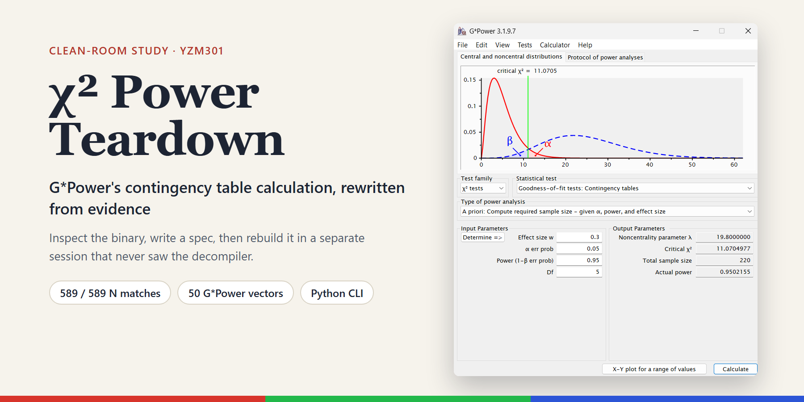
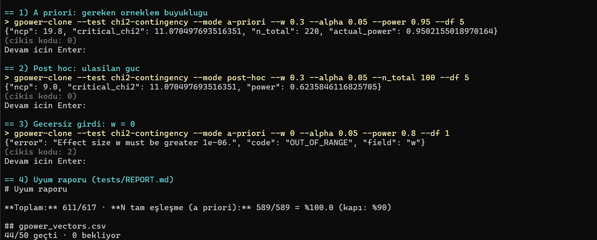
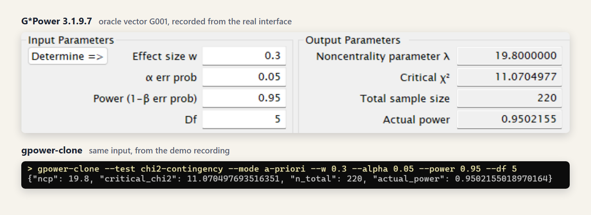

<p align="center">
  <a href="#demo">Demo</a> ·
  <a href="#what-it-does">What it does</a> ·
  <a href="#how-it-works">How it works</a> ·
  <a href="#results">Results</a> ·
  <a href="#run-it">Run it</a> ·
  <a href="#known-limits">Known limits</a> ·
  <a href="#türkçe">Türkçe</a>
</p>

**χ² Power Teardown** is a small command-line program that reproduces one calculation from G\*Power: *χ² tests → Goodness-of-fit tests: Contingency tables*. Give it an effect size, α, power and df, and it returns the required sample size. Give it a sample size instead, and it returns the power reached.

The point of the project is the proof, not the program. It was built for the YZM301 teardown sprint in three separated steps: collect the right answers, inspect the binary, then rewrite from the written spec alone.

> [!IMPORTANT]
> This project is not G\*Power and does not replace it. The calculation was studied for education and rewritten independently. The code contains no decompiled output, and `GPowerNT.exe` is not in this repository.

**Built with:** Python ≥ 3.10 · SciPy · pytest. Inspected with REA 6.7.0 and Ghidra 12.1.4.

## Demo

<p align="center"><a href="https://youtu.be/uQfWS3_VzAE"></a></p>

<p align="center"><sub><b>Fig. 1</b> · A frame from the real demo. Watch it on <a href="https://youtu.be/uQfWS3_VzAE">YouTube</a> or open <a href="docs/demo.mp4"><code>docs/demo.mp4</code></a>. The on-screen labels are in Turkish.</sub></p>

<p align="center"></p>

<p align="center"><sub><b>Fig. 2</b> · Oracle vector G001 in G*Power and in <code>gpower-clone</code>. Both crops come from real captures in this repository.</sub></p>

## What it does

<table>
  <tr><td><b>Two modes</b></td><td><code>a-priori</code> finds the required N. <code>post-hoc</code> finds the achieved power.</td></tr>
  <tr><td><b>JSON output</b></td><td>One line with <code>ncp</code>, <code>critical_chi2</code>, <code>n_total</code>, and <code>actual_power</code> or <code>power</code>.</td></tr>
  <tr><td><b>Input checks</b></td><td>Invalid input returns an error JSON and exit code <code>2</code>. Messages follow G*Power inside the contract's valid range.</td></tr>
  <tr><td><b>Evidence ledger</b></td><td>Each behaviour is tagged <code>[REA]</code> (binary evidence), <code>[DOK]</code> (manual) or <code>[AJAN]</code> (agent claim without evidence). See <a href="LEDGER.md"><code>LEDGER.md</code></a>.</td></tr>
  <tr><td><b>Differential tests</b></td><td>Compares the CLI with 50 G*Power vectors and 567 SciPy scale vectors.</td></tr>
  <tr><td><b>Hallucination log</b></td><td>Three confident but wrong agent claims, and how each was caught. See <a href="HALLUCINATIONS.md"><code>HALLUCINATIONS.md</code></a>.</td></tr>
</table>

## How it works

1. **Oracle.** `oracle/collect_gpower.ps1` records 50 vectors from the G\*Power 3.1.9.7 interface, each with a screenshot.
2. **Inspection.** In Session 1, an agent reads `GPowerNT.exe` with REA and Ghidra. Its claims go into `LEDGER.md`, and the behaviour goes into [`SPEC.md`](SPEC.md).
3. **Clean-room rewrite.** In Session 2, a separate agent that never saw Ghidra output writes `src/engine` and `src/cli` from the spec and the oracle.
4. **Check.** `tests/diff_test.py` compares the CLI with every vector and writes [`tests/REPORT.md`](tests/REPORT.md).

### What the binary revealed

| Behaviour | What G\*Power does | Vectors |
|---|---|:---:|
| N search | Finds a root over continuous N with Brent's method, then rounds up | G001–G021 |
| Upper bound | None: w = 0.001 gives N = 7,848,861 | G014 |
| Minimum N | 1, with no df-dependent lower bound | G016 |
| Power = α | Accepted and returns N = 1; power < α is an error | G017, G018 |
| Fractional post hoc N | Rounded to the nearest integer (10.2 → 10, 10.5 → 11) | G036–G038 |
| Fractional df | Used as given (df = 2.5) | G028 |
| Display | Usually 7 decimals; very small values and values ≥ 100 use `%.7g` | G020, G039–G050 |

## Results

| Measure | Recorded result |
|---|---|
| Exact a priori N match (gate: 90%) | **589 / 589 = 100%** |
| G\*Power vectors | 44 / 50, the other 6 are the contract conflicts below |
| SciPy scale vectors | 567 / 567 |
| pytest | 137 passed, 3 intentional xfails for bonus modes |
| Slowest call | 0.69 s (limit 2 s) |

### Where the contract and G\*Power disagree

[`CONTRACT.md`](CONTRACT.md) §5 rejects some inputs that G\*Power accepts. Outside the valid range this program follows the contract, because the course harness tests against it.

| Vector | Input | Contract | G\*Power 3.1.9.7 |
|:---:|---|---|---|
| G028 | `df = 2.5` | Reject | N = 115 |
| G035 | post hoc `n_total = 1` | Reject | Power = 0.0603726 |
| G036–G038 | post hoc `n_total = 10.2 / 10.5 / 10.7` | Reject | Rounds to 10 / 11 / 11 |
| G039 | post hoc `w = 0` | Reject | Power = α = 0.05 |

## Run it

```bash
git clone https://github.com/huseyinbaranisik/G-Power.git
cd G-Power
python -m venv .venv
.venv/Scripts/python -m pip install -e ".[test]"
```

On macOS or Linux, use `.venv/bin/` instead of `.venv/Scripts/`.

```bash
# A priori: required sample size
.venv/Scripts/gpower-clone --test chi2-contingency --mode a-priori --w 0.3 --alpha 0.05 --power 0.95 --df 5
# {"ncp": 19.8, "critical_chi2": 11.070497693516351, "n_total": 220, "actual_power": 0.9502155018970164}

# Post hoc: achieved power
.venv/Scripts/gpower-clone --test chi2-contingency --mode post-hoc --w 0.3 --alpha 0.05 --n_total 100 --df 5
# {"ncp": 9.0, "critical_chi2": 11.070497693516351, "power": 0.6235846116825705}
```

Checks:

```bash
.venv/Scripts/python -m pytest -q
```

```bash
PATH="$PWD/.venv/Scripts:$PATH" python tests/diff_test.py oracle/gpower_vectors.csv oracle/scale_vectors.csv
```

## Known limits

- Only `chi2-contingency` is implemented, in two modes.
- The optional MCP server and AI agent layers were not built.
- Two claims in the hallucination log have no distinguishing oracle vector. They rest on assembly evidence alone.

## Credits

- G\*Power 3.1.9.7 by Faul, Erdfelder, Lang and Buchner. The official download is at [psychologie.hhu.de](https://www.psychologie.hhu.de/).
- Faul, F., Erdfelder, E., Lang, A.-G., & Buchner, A. (2007). G\*Power 3. *Behavior Research Methods, 39*, 175–191.
- Faul, F., Erdfelder, E., Buchner, A., & Lang, A.-G. (2009). Statistical power analyses using G\*Power 3.1. *Behavior Research Methods, 41*, 1149–1160.
- Course contract: [YZM301 gist](https://gist.github.com/seyyah/08d3e031781d853b17366be8ba264211), version 1.0.0.

---

## Türkçe

**χ² Power Teardown**, G\*Power'ın *χ² tests → Goodness-of-fit tests: Contingency tables* hesabını yeniden üreten küçük bir komut satırı programı. Etki büyüklüğü, α, güç ve df verirsen gereken örneklemi, örneklem verirsen ulaşılan gücü hesaplar.

Projenin asıl amacı program değil, doğruluğunun kanıtı. YZM301 teardown sprinti için üç ayrı adımda yapıldı: doğru cevapları topla, binary'yi incele, sonra yalnızca yazılı şartnameden yeniden yaz.

> [!IMPORTANT]
> Bu proje G\*Power değildir ve onun yerine geçmez. Hesap eğitim amacıyla incelenip bağımsız olarak yeniden yazıldı. Kodda decompile çıktısı yoktur, `GPowerNT.exe` bu repoda bulunmaz.

**Teknoloji:** Python ≥ 3.10 · SciPy · pytest. İnceleme: REA 6.7.0 ve Ghidra 12.1.4.

### Demo

Şekil 1, gerçek demo kaydından bir kare: a priori sonuç, post hoc sonuç, geçersiz girdi ve uyum raporu. Videoyu [YouTube'da](https://youtu.be/uQfWS3_VzAE) izleyebilir ya da [`docs/demo.mp4`](docs/demo.mp4) dosyasını açabilirsin. Şekil 2, G001 vektörünü G\*Power'da ve `gpower-clone`'da gösterir.

### Neler yapıyor

- **İki mod:** `a-priori` gereken N'yi, `post-hoc` ulaşılan gücü bulur.
- **JSON çıktı:** Tek satırda `ncp`, `critical_chi2`, `n_total` ve `actual_power` ya da `power`.
- **Girdi kontrolü:** Geçersiz girdide hata JSON'u ve `2` çıkış kodu döner.
- **Kanıt defteri:** Her davranış `[REA]`, `[DOK]` ya da `[AJAN]` olarak etiketli ([`LEDGER.md`](LEDGER.md)).
- **Diferansiyel test:** 50 G\*Power ve 567 SciPy ölçek vektörüyle karşılaştırır.
- **Halüsinasyon günlüğü:** Ajanın kendinden emin ama yanlış üç iddiası ve nasıl yakalandıkları ([`HALLUCINATIONS.md`](HALLUCINATIONS.md)).

### Nasıl çalışıyor

1. **Kâhin:** `oracle/collect_gpower.ps1`, G\*Power 3.1.9.7 arayüzünden ekran görüntüleriyle 50 vektör toplar.
2. **İnceleme:** Oturum 1'de bir ajan `GPowerNT.exe`'yi REA ve Ghidra ile okur. İddialar `LEDGER.md`'ye, davranış [`SPEC.md`](SPEC.md)'ye yazılır.
3. **Temiz oda yazımı:** Oturum 2'de Ghidra çıktısını hiç görmeyen ayrı bir ajan, kodu şartname ve kâhinden yazar.
4. **Kontrol:** `tests/diff_test.py` CLI'ı tüm vektörlerle karşılaştırıp [`tests/REPORT.md`](tests/REPORT.md) dosyasını üretir.

### Sonuçlar

| Ölçüm | Kayıtlı sonuç |
|---|---|
| A priori N tam eşleşmesi (eşik %90) | **589 / 589 = %100** |
| G\*Power vektörleri | 44 / 50, kalan 6'sı sözleşme çelişkisi |
| SciPy ölçek vektörleri | 567 / 567 |
| pytest | 137 geçti, bonus modlar için 3 bilinçli xfail |
| En yavaş çağrı | 0.69 s (sınır 2 s) |

[`CONTRACT.md`](CONTRACT.md) §5, G\*Power'ın kabul ettiği bazı girdileri reddeder. Ders düzeneği sözleşmeye göre test ettiği için program geçerli aralığın dışında sözleşmeye uyar. Çelişen vektörler: G028, G035, G036–G038 ve G039.

### Çalıştır

```bash
git clone https://github.com/huseyinbaranisik/G-Power.git
cd G-Power
python -m venv .venv
.venv/Scripts/python -m pip install -e ".[test]"
.venv/Scripts/gpower-clone --test chi2-contingency --mode a-priori --w 0.3 --alpha 0.05 --power 0.95 --df 5
```

macOS ve Linux'ta `.venv/Scripts/` yerine `.venv/bin/` kullan. Testler için:

```bash
.venv/Scripts/python -m pytest -q
```

### Bilinen sınırlar

- Yalnızca `chi2-contingency` testi ve iki mod var.
- İsteğe bağlı MCP sunucusu ve AI ajanı katmanları yapılmadı.
- Halüsinasyon günlüğündeki iki iddiayı ayırt eden kâhin vektörü yok, bunlar yalnızca assembly kanıtına dayanıyor.
